  

## `▶ NEW GAME`

¡Hola! Soy **Marco**. Hago videojuegos y, cuando hace falta, también lo que corre detrás de ellos.
Me lo paso igual de bien ajustando cómo salta un personaje que montando el servidor que guarda la partida.

- 🎮 Si algo se puede jugar, quiero saber cómo está hecho.
- ⏱️ Game jams: pocas horas, mucho café y alguna idea que sale bien.
- 🌱 Ahora mismo subiendo de nivel en **Kotlin Multiplatform** y **Go**.

## `🎒 INVENTARIO`

  

## `⚔️ MISIÓN ACTUAL`

> ### [🎲 DnD-quedamos](https://github.com/patosalvaje12121-ctrl/DnD-quedamos)
> App para organizar quedadas y eventos, con mapa incluido.
> Funciona en **Android, Web y Escritorio**, todo con **Kotlin + Compose Multiplatform**.
>
> **Mi parte:** usuarios y eventos (modelos de datos, estructura y casos de uso).

---

  <code>CONTINUE? ▶ SÍ · NO</code>

